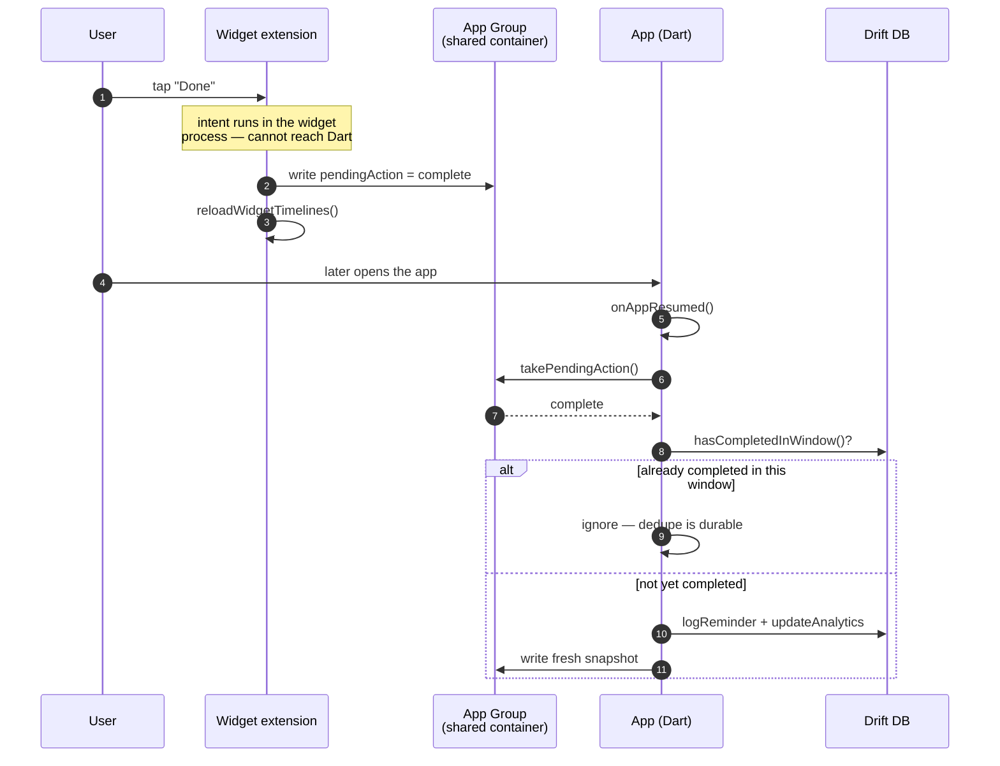
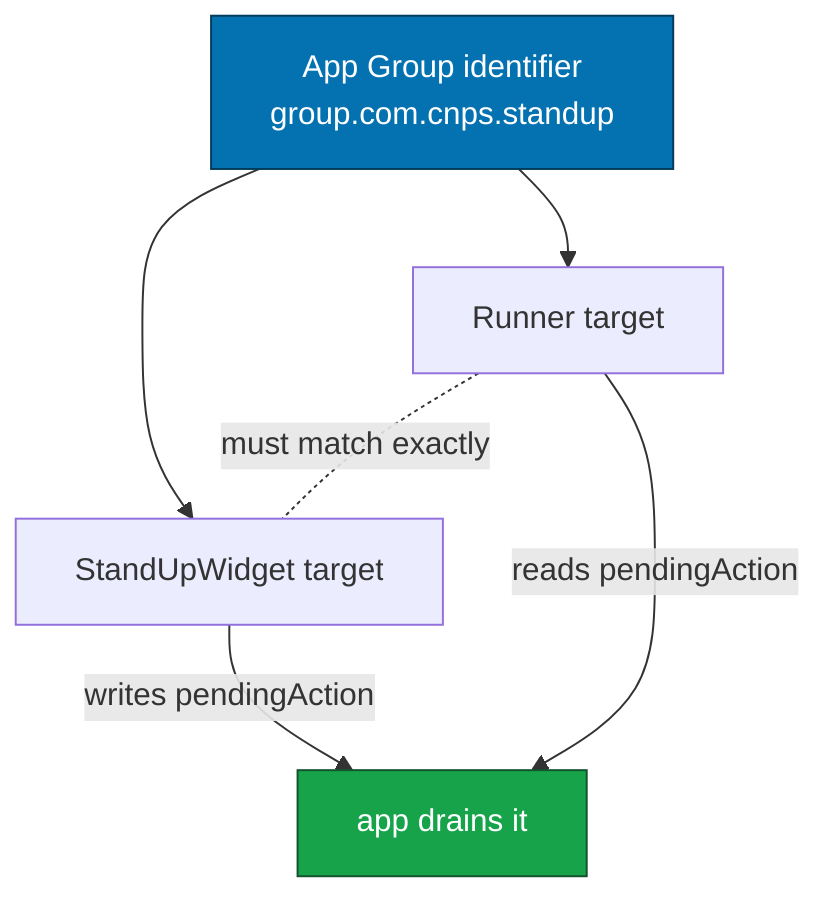

# Platform setup

What each target needs before it will build, and what CI can and cannot do for
you. Written for someone setting this up for the first time.

---

## What builds where

| Target | Builds locally on | Builds in CI | Notes |
| --- | --- | --- | --- |
| Android | Windows, macOS, Linux | `ubuntu-latest` | Needs Android SDK + a JDK |
| Web | Any | `ubuntu-latest` | No native toolchain at all |
| Linux | Linux only | `ubuntu-latest` | GTK, clang, ninja |
| Windows | Windows only | `windows-latest` | Needs Visual Studio **with the C++ workload** |
| macOS | macOS only | `macos-14` | Needs Xcode. **Not built: see below** |
| iOS | macOS only | `macos-14` | Needs Xcode + the WidgetKit target installed. **Not built: see below** |

The platform restriction is not a limitation of the project. Flutter's Windows
embedder links against Win32 and the macOS and Linux embedders link against
Cocoa and GTK respectively, so there is no cross-compilation path for desktop
targets. CI works around it by using a hosted runner of the matching OS.

---

## iOS and macOS are not currently in a release

As of **v1.0.1** no published release contains an iOS or macOS build. The Apple
CI job runs and fails; the other five targets build and publish.

The WidgetKit extension now compiles — two genuine defects in
`ios/StandUpWidget/` were fixed for v1.0.1 (`WidgetPayload.swift` declared
SwiftUI `Color` properties while importing only Foundation, and
`StandUpProvider` read a `payload.date` that does not exist). What remains is an
Xcode build-graph failure, not a source failure:

```
Error (Xcode): Cycle inside Runner; building could produce unreliable results.
→ Target 'Runner' has copy command from '.../StandUpWidget.appex'
  to '.../Runner.app/PlugIns/StandUpWidget.appex'
```

The Embed App Extensions copy phase, Flutter's "Thin Binary" script phase and
`ProcessInfoPlistFile` form a dependency cycle. Diagnosing it needs a macOS host
with Xcode, because the pbxproj is rewritten at build time by
`scripts/ios/add_widget_target.rb` and the result cannot be inspected from
another OS.

Until that is fixed, the Apple job is the **only** job that does not block
`publish`, and the release body carries a warning banner naming the omission.
That exception is deliberate and temporary: v1.0.0 shipped with no iOS or macOS
artefact under the old `!cancelled()` rule and nothing said so. To restore
strict behaviour, remove `apple` from the `needs` list and the `if` condition
in `publish` in `.github/workflows/release.yml`.

---

## Android

Nothing special beyond the standard Flutter toolchain. Two things are worth
knowing:

- The adaptive launcher icon has three layers (`background`, `foreground`,
  `monochrome`) defined in
  `android/app/src/main/res/mipmap-anydpi-v26/ic_launcher.xml`. The monochrome
  layer is what Android 13 uses for themed icons; without it the app silently
  opts out of the user's wallpaper palette.
- Notification icons are the small silhouette shown in the status bar. Android
  tints them and ignores colour, so supplying the full-colour logo produces a
  white or black blob.

## Linux

Install the build dependencies once:

```bash
./scripts/standup.sh setup --linux-deps
# or, without the TUI:
sudo apt-get install -y clang cmake ninja-build pkg-config libgtk-3-dev \
  liblzma-dev libstdc++-12-dev libblkid-dev uuid-dev libxss-dev \
  libgstreamer1.0-dev libgstreamer-plugins-base1.0-dev
```

The GStreamer packages are required by `audioplayers_linux`. Omitting them makes
the build fail inside CMake at `pkg_check_modules` with a confusing message
about a package you were never told to install.

`libxss-dev` is the one *optional* entry: it is only needed by the X11 presence
reader. Without it the app still builds, presence detection reports "unavailable"
in Settings → Device, and reminders always sound.

### Reminder delivery on Linux

`flutter_local_notifications` on Linux only supports *immediate* notifications,
so `NotificationService` keeps a foreground timer per queued reminder and shows
it at the due time (`_linuxTimers`). Two consequences:

- The app must be **running** for a reminder or a prelude warning to appear. A
  closed app has no timer to fire. This is the same limit the README records for
  desktop.
- The queue is therefore bounded by process memory rather than an OS request
  budget, but the app still schedules the same fixed number of slots so the two
  platforms behave alike.

The prelude (the "get ready to stop" warning) is scheduled here as an OS
notification in the `standup_prelude_channel`/`standup_prelude` series,
offset five minutes before each reminder. It is desktop-only by design: see
`NotificationService._supportsPreludeQueue`.

## Windows

Requires Visual Studio 2022 with the **Desktop development with C++** workload.
The plain Visual Studio install is not enough; `flutter doctor` will tell you so:

```
[✗] Visual Studio - develop Windows apps.
    ✗ Missing "Visual Studio 2022" component.
```

CI builds this on the hosted `windows-latest` image, which already has the
workload, so the job is not gated.

### Presence detection (all platforms)

The decision logic is Dart and tested. Both desktop readers are implemented:
`GetLastInputInfo` in `windows/runner/flutter_window.cpp` and the XScreenSaver
extension in `linux/runner/my_application.cc`. Both are answered over
`standup/presence`, so `presenceDetectionAvailable` reflects what the platform
actually answered rather than what was compiled. On a platform with no reader,
reminders always sound; Settings → Device says which case you are in, on purpose.

| Platform | Reader | Status |
| --- | --- | --- |
| Windows | `GetLastInputInfo`, answered over `standup/presence` | implemented; **runtime unverified** here, CI only compiles it |
| Linux (X11) | MIT-SCREEN-SAVER via `XScreenSaverQueryInfo` | implemented; **runtime unverified** here, CI only compiles it |
| Linux (Wayland) | no portable idle API | reports "unknown"; documented as unsupported |
| Android | interactive/`PowerManager` state | not implemented |
| macOS / Web | — | not planned |

`gdk_display_get_default()` is checked against `GDK_IS_X11_DISPLAY` before any
X call, so a Wayland session never gets an idle reading from the XWayland
connection it may still have. The reader is also compiled out entirely when
`libxss-dev` is absent (see the `XSCRNSAVER_FOUND AND X11_FOUND` guard in
`linux/runner/CMakeLists.txt`), which reports "unknown" — the same answer as
Wayland, and never a fabricated zero.

Two libraries are involved and both are named explicitly: MIT-SCREEN-SAVER lives
in `libXss`, while `XFree` and `DefaultRootWindow` live in `libX11`. A shared
library does not re-export its own dependencies' symbols, so listing only `Xss`
configures cleanly and then fails at the link step with an X11 function in the
error — the defect this paragraph exists to explain. `libx11-dev` is already
required by `libgtk-3-dev`, so the extra dependency is never new to a machine
that can build the runner at all.

`PlatformIdleTimeSource.isSupported` short-circuits the channel call on platforms
without a reader, and the source itself degrades a missing implementation to
`null`, so a mobile build never pays for a platform round-trip every polling
interval only to learn nothing is registered. The threshold, hysteresis and
clock-jump handling all live in `core/presence.dart` and need no
platform-specific tests; a reader only has to answer milliseconds.

Nothing read here is uploaded: see the local-only boundary in
`docs/ARCHITECTURE.md`.

**What presence does and does not silence.** It withholds the in-app chime and
the five-minute cue, and it vetoes the forced break, so an empty desk is never
nagged or covered. The same veto governs **escalation**: a streak of ignored
breaks only ever counts while a presence reading is available, so on any platform
that reports no idle time the feature is inert rather than guessing, and it never
charges a window that closed while nobody was there. It does **not** withdraw a
notification the OS has already
been asked to deliver: the reminder and prelude series are scheduled ahead of
time and fire on the platform's clock, with their sound. On Windows and Linux a
scheduled reminder can therefore still appear while nobody is at the machine.
Cancelling one at fire time would need a delivery event the platforms do not give
this app, which is why Settings describes the silence as applying to the in-app
chime rather than to reminders in general.

### The forced break is not an OS lock

`BreakBlockOverlay` is a Flutter `ModalBarrier` plus a full-window `Material`.
It is authoritative *inside* the app — no tap, scroll or drag reaches the screen
underneath — but on its own it cannot stop the user switching to another
application.

Escalation shows the same cover. It is not a stronger form of the block and it is
no closer to an OS lock: it changes *when* the cover may appear (after a streak of
ignored breaks, on a limit the employee sets), never what the cover can do, and it
is subject to every veto above, presence included.

Two platforms now also raise the window while the block is active, over the
`standup/window` channel (`setKeepAbove`):

| Platform | Implementation | Status |
| --- | --- | --- |
| Windows | `SetWindowPos` with `HWND_TOPMOST` / `HWND_NOTOPMOST` in `windows/runner/flutter_window.cpp` | implemented; **runtime unverified** here, CI only compiles it |
| Linux (X11) | `gtk_window_set_keep_above`, i.e. `_NET_WM_STATE_ABOVE` in `linux/runner/my_application.cc` | implemented; **runtime unverified** here, CI only compiles it |
| Linux (Wayland) | no equivalent protocol | compositor may ignore the request; the call still succeeds |
| Android / Apple / Web | — | not planned |

Keep-above is a standing property of the window rather than a one-shot raise, so
it holds without re-asserting on every focus change. The channel deliberately
does **not** activate, restore or un-minimise the window: stealing focus is a
separate promise, and a window the user minimised while the block is due is left
alone. Alt-Tab, Super and window-manager shortcuts remain available on every
platform, so the feature is documented as "covers the app and stays in front",
not "locks the screen". An OS-level lock remains a separate, unstarted tier.

`WindowChrome` degrades to a no-op wherever the native side is missing, and both
directions are only sent on a transition, so a normal run never touches the
channel at all.

The cover also waits a short anti-cheat delay before it accepts "I stood up":
`BreakBlockScreen.defaultMinWaitSeconds` (30 seconds), so a reflexive two-second
dismissal no longer counts as a break. The delay is capped by the remaining
window: someone who arrives with ten seconds left waits ten, not thirty, because
the cover lifts when the window closes and a longer wait would point at a button
that disappears before it unlocks. A window that has already closed skips the
delay entirely. The value is a constant rather than a setting for now.

### Reminder delivery on Windows

Windows uses scheduled toast notifications, so a reminder can fire while the app
is in the background. As on Linux, the prelude warning is scheduled as a
separate desktop-only series offset before each reminder. Neither path has been
verified on a real Windows host from this repository — the CI job only proves
that the bundle *compiles*.

---

## Starting with the session (Windows and Linux)

Delivery limits above share one cause: nothing happens unless the app is
running. Settings → **Startup** registers the app with the desktop session so a
reboot does not silently end the reminders.

| Platform | Mechanism |
| --- | --- |
| Windows | `REG_SZ` value `StandUp` under `HKCU\Software\Microsoft\Windows\CurrentVersion\Run`, written through `reg.exe` — the same entry Task Manager shows under Startup apps. The path is quoted, because the value is a command line and an install under `C:\Program Files\…` would otherwise be split at the first space. |
| Linux | `standup.desktop` in `${XDG_CONFIG_HOME:-$HOME/.config}/autostart`, the freedesktop convention every desktop environment reads. |
| macOS, Android, iOS, web | Not supported; Settings says so rather than pretending. |

No native code and no new dependency are involved. The session entry is the
state of record: `AppState` reads it at startup instead of storing a flag, so an
entry removed from the desktop settings cannot leave the switch claiming the
opposite. A Linux entry that names a different binary (an old debug path) reads
as *disabled* and is rewritten when the user switches it on.

Not verified on a real desktop session from this repository. The Dart contract —
which file, which registry value, which read-back — is covered by
`test/autostart_test.dart`.

---

## Apple: WidgetKit and interactive widgets

Apple targets need two extra steps that no amount of CI will do for you.

### 1. Install the WidgetKit extension target

The Swift sources live in `ios/StandUpWidget/` but are not part of the Xcode
project until you add them:

```bash
ruby scripts/ios/add_widget_target.rb
open ios/Runner.xcworkspace
```

The script is idempotent — it refuses to add the target twice — so it is safe to
re-run after a `flutter create`. It creates the target with:

- bundle id `<app bundle id>.StandUpWidget`
- deployment target 17.0 for interactive WidgetKit actions
- the `group.<app bundle id>` App Group on **both** targets
- an embed-extension build phase in `Runner`

### 2. Enable the capability on both targets

Signing will fail without this. In Xcode, select **Runner** and
**StandUpWidget**, then for each: *Signing & Capabilities → + Capability → App
Groups*, and enable the group created above.

The App Group is what lets the app write a countdown into the widget's
container, and lets an interactive widget button hand an action back to Dart.

### 3. Enable the Apple CI job

Repository variable `RUN_APPLE_CI = true`. These builds are **unsigned** — CI
has no signing identity — so they are useful for verification and simulator
work, not for App Store submission.

---

## The interactive-widget action round trip

Worth understanding because it is the least obvious part of the Apple setup:

1. The user taps **Done** in the widget.
2. The App Intent runs in the **widget extension** process. It cannot call into
   Dart, and starting the app to reach Dart would defeat the purpose of a
   widget action.
3. Instead the intent writes a small pending-action record into the shared App
   Group container and reloads the timeline.
4. The app drains that record on next `resume`, through
   `AppState.onAppResumed` → `WidgetBridge.takePendingAction`.



So an interactive widget action is applied the next time the user opens the app,
not the instant they tap it. The same durability mechanism applies on Android via
`HomeWidget.registerInteractivityCallback`.

If an action appears to do nothing, check that the App Group identifier matches
exactly on both targets — a mismatch compiles cleanly and silently sends the
pending action to a container nothing is reading.


